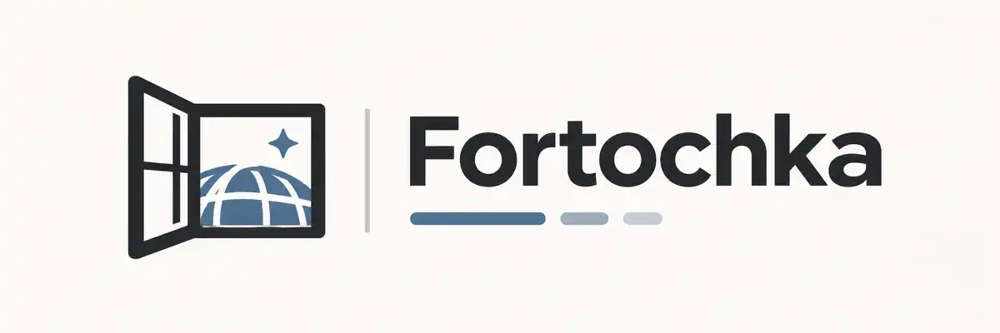

<p align="center">
  
</p>

<p align="center">
  <strong>Telegram Web K as a standalone desktop app for Windows and macOS.</strong><br>
  A local proxy, live fronts, and DNS-over-HTTPS.
</p>

<p align="center">
  <a href="https://github.com/doctorBax/fortochka/releases/latest">Download Stable</a> ·
  <a href="https://github.com/doctorBax/fortochka/releases">Beta builds</a> ·
  <a href="README.md">Русский</a>
</p>

---

## What it is

**Fortochka** is a desktop wrapper around [Telegram Web K](https://github.com/morethanwords/tweb). It uses available web fronts to reach Telegram when direct connections to its web endpoints are unavailable. It is neither a separate messenger nor a VPN.

- **Live fronts.** Updated front lists, connectivity checks, and preference for reachable endpoints.
- **DNS-over-HTTPS.** Alternative name resolution when the system resolver fails.
- **Local networking.** A locally served interface and restricted HTTP CONNECT proxy.
- **Desktop integration.** System tray, notifications, and network diagnostics.

## Downloads

| Channel | Intended use | Builds |
| --- | --- | --- |
| **[Stable](https://github.com/doctorBax/fortochka/releases/latest)** | Regular use | Windows installer and portable |
| **[Beta](https://github.com/doctorBax/fortochka/releases)** | Experimental changes; bugs are expected | Windows and macOS, marked *Pre-release* |

macOS DMG availability depends on the particular release. For installation of unsigned macOS builds, see the [macOS guide](docs/install-macos.md) (Russian).

Sign in to Telegram as usual. Closing the window minimizes to tray. Network and front status are available under **Tray → Diagnostics**.

## Development

```bash
npm ci
npm start
```

Packaging: `npm run dist` (Windows), `npm run dist:mac` (macOS). The bundled Telegram Web K assets are already included.

**Details:** [architecture, configuration, diagnostics and builds](docs/technical-en.md) · [front list](fronts.json) · [report an issue](https://github.com/doctorBax/fortochka/issues).

## Privacy and licensing

Fortochka is not an anonymity tool: network operators can observe connection metadata. Telegram cloud chats are not end-to-end encrypted between participants.

[GPL-3.0-or-later](LICENSE). Includes [Telegram Web K](https://github.com/morethanwords/tweb) (GPL-3.0) and [tg-ws-proxy-rs](https://github.com/valnesfjord/tg-ws-proxy-rs) (MIT).
