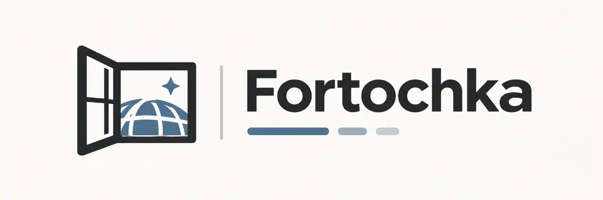

<p align="center">
  
</p>

<p align="center">
  <strong>Telegram Web K — как отдельное приложение для Windows и macOS.</strong><br>
  Локальный прокси, живой список фронтов и DNS-over-HTTPS.
</p>

<p align="center">
  <a href="https://github.com/doctorBax/fortochka/releases/latest">Скачать Stable</a> ·
  <a href="https://github.com/doctorBax/fortochka/releases">Сборки Beta</a> ·
  <a href="README.en.md">English</a>
</p>

---

## Что это

**Fortochka** — настольная оболочка для [Telegram Web K](https://github.com/morethanwords/tweb). Она помогает подключаться к Telegram через доступные веб-фронты, когда прямое соединение с его веб-адресами не работает. Это не отдельный мессенджер и не VPN.

- **Живые фронты.** Список обновляется, доступность проверяется, предпочтение отдаётся работающим адресам.
- **DNS-over-HTTPS.** Альтернативное разрешение имён, когда системный DNS не справляется.
- **Локальная сеть.** Веб-интерфейс работает через локальный сервер и ограниченный HTTP CONNECT-прокси.
- **Нативное окно.** Трей, уведомления и диагностическая страница.

## Скачать

| Канал | Для кого | Сборки |
| --- | --- | --- |
| **[Stable](https://github.com/doctorBax/fortochka/releases/latest)** | Обычное использование | Windows: установщик и portable |
| **[Beta](https://github.com/doctorBax/fortochka/releases)** | Экспериментальные изменения; возможны ошибки | Windows и macOS, релизы с пометкой *Pre-release* |

На macOS доступность DMG зависит от конкретного релиза. Если macOS блокирует неподписанное приложение, см. [инструкцию по установке](docs/install-macos.md).

После запуска войдите в Telegram привычным способом. Закрытие окна сворачивает приложение в трей; состояние сети и фронтов доступно через **Трей → Диагностика**.

## Разработчикам

```bash
npm ci
npm start
```

Сборки: `npm run dist` (Windows), `npm run dist:mac` (macOS). Исходная веб-часть основана на Telegram Web K; её сборка уже включена в репозиторий.

**Подробнее:** [архитектура, настройки, диагностика и сборка](docs/technical-ru.md) · [исходный список фронтов](fronts.json) · [сообщить об ошибке](https://github.com/doctorBax/fortochka/issues).

## Приватность и лицензия

Fortochka не обеспечивает анонимность: операторы сетевой инфраструктуры могут видеть метаданные соединений. Облачные чаты Telegram также не являются сквозно зашифрованными между собеседниками.

[GPL-3.0-or-later](LICENSE). В составе используются [Telegram Web K](https://github.com/morethanwords/tweb) (GPL-3.0) и [tg-ws-proxy-rs](https://github.com/valnesfjord/tg-ws-proxy-rs) (MIT).
